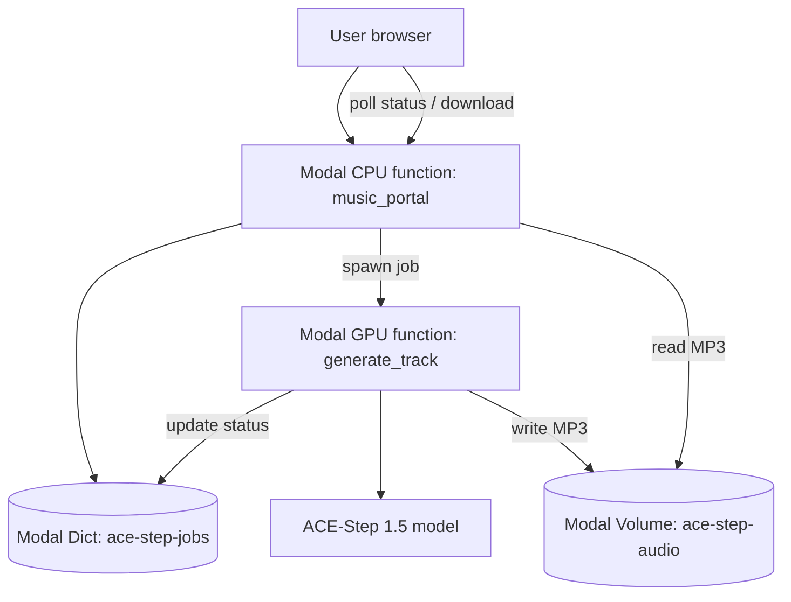
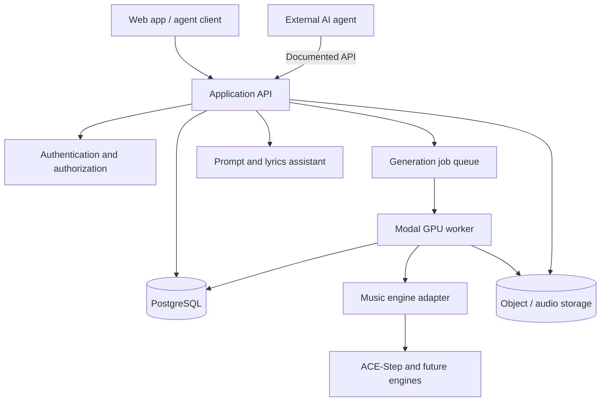

# SONORA Architecture

## 1. Current working system

The initial deployment separates the browser-facing service from the GPU generation worker.

### Current components

| Component | Responsibility | Current implementation |
|---|---|---|
| Web portal | Form, submit, poll, download | FastAPI + embedded HTML on Modal CPU |
| Job store | Share job state between functions | Modal Dict named `ace-step-jobs` |
| Generation worker | Load model and produce audio | Modal GPU function `generate_track` |
| Model | Music generation | ACE-Step 1.5 Turbo DiT + 5Hz LM |
| Checkpoint storage | Retain model weights | Modal Volume `ace-step-checkpoints` |
| Audio storage | Retain generated MP3 files | Modal Volume `ace-step-audio` |

The portal function is configured separately from the GPU worker. The GPU worker has `min_containers=0`, `max_containers=1`, and a short scale-down window. The intended operating mode is to allocate GPU compute when a generation job is submitted and scale it down when idle.

## 2. Current request lifecycle

1. Browser submits a prompt, optional lyrics, and duration to `POST /api/generate`.
2. The portal validates the request and creates a job record in the Modal Dict.
3. The portal spawns `generate_track`.
4. The worker initializes ACE-Step, generates audio, and writes an MP3 under a job-specific directory in the audio Volume.
5. The worker commits the Volume and marks the job complete with a download token.
6. Browser polls `GET /api/status/{job_id}` and receives a download link when complete.
7. Browser downloads from `GET /api/download/{job_id}`.

## 3. Known limitations to address

- The web interface does not expose a persistent track library.
- The interface exposes only prompt, lyrics, and duration.
- Vocal language is currently passed as `unknown`.
- A single shared password protects generation; there is no user identity or multi-user authorization.
- Job records and audio files are stored separately; lifecycle, retention, and reconciliation need explicit design.
- Model initialization currently occurs inside the generation function invocation. Reuse and warm-container behavior should be measured rather than assumed.
- There is no formal test suite, structured observability, or cost/performance dashboard yet.

## 4. Target architecture

This is a target direction, not a statement that these components are already implemented.

### Design boundaries

- **Frontend:** user experience, forms, track player, library, and job feedback.
- **Application API:** request validation, authorization, job lifecycle, metadata, and storage access.
- **Music engine adapter:** isolates model-specific inputs and outputs from the rest of SONORA.
- **GPU worker:** runs inference and reports durable job state.
- **Database:** authoritative users, tracks, jobs, and metadata.
- **Audio storage:** generated audio and future derived assets.
- **Agent API:** documented, permissioned operations for AI agents; it should use the same validation and job lifecycle as the web app.

## 5. Engineering requirements

1. Never store credentials in the repository.
2. Do not expose a raw Modal worker or storage path to unauthenticated users.
3. Validate prompt, lyrics, duration, language, and supported generation options server-side.
4. Treat job state as durable and recoverable across process restarts.
5. Make generation idempotency and duplicate submission behavior explicit.
6. Record model revision, settings, seed (when available), timestamps, duration, output path, and error details for each generation.
7. Provide health checks that do not wake the GPU worker.
8. Measure cold-start time, model initialization, inference time, output duration, failure rate, and estimated cost.
9. Keep the current production deployment separate from experimental changes until tests pass.
